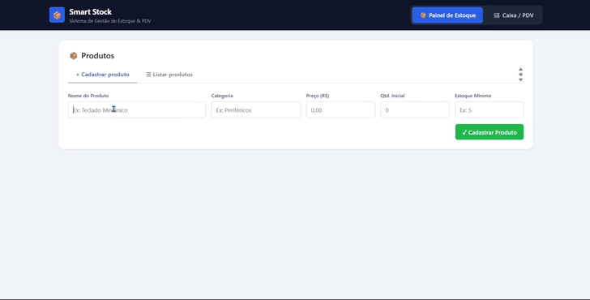
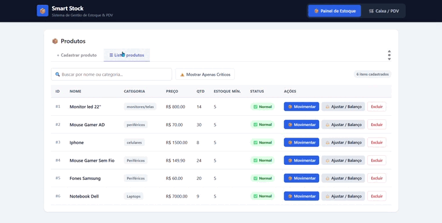
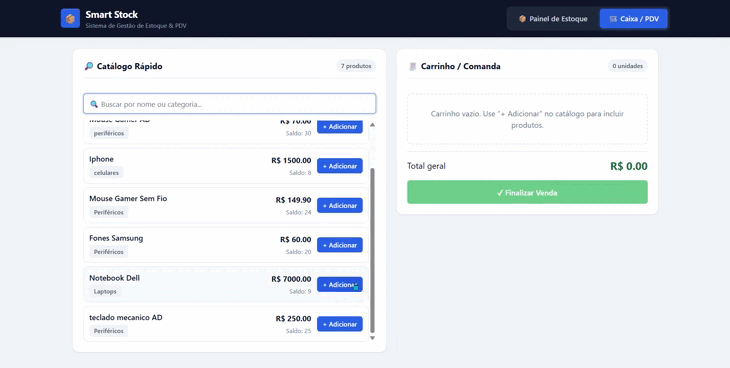

# 📦 Smart Stock

[](https://smartstock-pdv.vercel.app/)
[](https://spring.io/projects/spring-boot)
[](https://swagger.io/)
[](https://www.oracle.com/java/)
[](https://react.dev/)
[](https://github.com/)

Sistema full-stack para **Gestão de Estoque e Frente de Caixa (PDV)** voltado ao varejo, com controle de saldo em tempo real, ajustes de inventário, alertas de ruptura e vendas atômicas com histórico auditável de movimentações.

---

## 🌐 Demonstração Online

A aplicação está disponível e hospedada publicamente:

- **Frontend (PDV & Gestão de Estoque):** [https://smartstock-pdv.vercel.app/](https://smartstock-pdv.vercel.app/)

> Você pode navegar pela interface, simular adição de produtos ao carrinho, calcular subtotais e testar os filtros de estoque e busca em tempo real.

---

## 🎬 Demonstração

| Cadastro de produtos | Movimentação de estoque | Venda no PDV |
| :---: | :---: | :---: |
|  |  |  |

---

## 🛠️ Tecnologias Utilizadas

### Backend
- **Linguagem & Framework:** Java 21 & Spring Boot 4.1.1
- **Acesso a Dados:** Spring Data JPA & Hibernate
- **Validação:** Jakarta Bean Validation (`@Valid`, constraints nos DTOs)
- **Documentação da API:** SpringDoc OpenAPI 3 / Swagger UI
- **Build & Dependências:** Apache Maven Wrapper (`mvnw`)

### Frontend
- **Interface:** React 19
- **Build Tool:** Vite
- **Comunicação HTTP:** Axios
- **Qualidade de Código:** Oxlint

### Banco de Dados
- **Aplicação (desenvolvimento e deploy):** MySQL 8+
- **Testes automatizados:** H2 em memória, isolado por perfil de teste

---

## 📁 Estrutura do Repositório

```text
smartstock/
├── .agents/                    # Diretrizes e skills usadas pelos agentes de IA no desenvolvimento
├── api-requests/               # Coleção de requisições prontas para o Bruno (REST API)
│   └── SmartStock API/
│       ├── Movimentações/
│       ├── Produtos/
│       └── Vendas/
├── docs/                       # Documentação de arquitetura, requisitos e mídias (docs/img)
├── smart-stock-backend/        # API REST Spring Boot (Java 21)
│   ├── src/main/java/          # Controllers, Services, DTOs, Entidades e Repositories
│   └── src/test/java/          # Testes unitários, de controller e de integração
└── smart-stock-frontend/       # Aplicação SPA React (Vite)
    └── src/                    # Telas (Painel de Estoque e PdvView), estilos e componentes
```

> O projeto foi desenvolvido com apoio de agentes de IA. A pasta `.agents/` guarda as regras e
> skills que orientam esse fluxo. Toda alteração é validada com testes e revisão manual.

---

## 🚀 Como Executar o Projeto

### Pré-requisitos
- **Java 21** instalado e configurado no `PATH`.
- **Node.js 20+** e **npm** instalados.
- **MySQL 8+** ativo localmente na porta padrão `3306`.

### 1. Backend (`smart-stock-backend`)

#### Variáveis de ambiente
O backend conecta-se ao MySQL usando `DB_USERNAME` e `DB_PASSWORD`.

**Windows (PowerShell):**
```powershell
$env:DB_USERNAME = "root"
$env:DB_PASSWORD = "sua_senha_aqui"
```

**Linux / macOS (Bash):**
```bash
export DB_USERNAME="root"
export DB_PASSWORD="sua_senha_aqui"
```

> **Nota:** o banco `smartstock` é criado automaticamente caso não exista (`createDatabaseIfNotExist=true`).

#### Executar
```bash
cd smart-stock-backend
# Windows:
.\mvnw.cmd spring-boot:run

# Linux / macOS:
./mvnw spring-boot:run
```

A API estará em `http://localhost:8080`:
- **Swagger UI:** [http://localhost:8080/swagger-ui.html](http://localhost:8080/swagger-ui.html)
- **OpenAPI JSON:** [http://localhost:8080/v3/api-docs](http://localhost:8080/v3/api-docs)

### 2. Frontend (`smart-stock-frontend`)

```bash
cd smart-stock-frontend
npm install
npm run dev
```

A aplicação abre em `http://localhost:5173`.

#### Endereço da API
Por padrão, o frontend consome a API em `http://localhost:8080`.
Para apontar para outro endereço (por exemplo, o backend em produção), defina a variável
`VITE_API_URL` antes de rodar ou gerar o build:

```bash
# .env.local (na pasta smart-stock-frontend)
VITE_API_URL=https://SEU_BACKEND_AQUI
```

---

## 🔌 Endpoints da API

Documentação interativa completa em `/swagger-ui.html`. Resumo por recurso:

<details open>
<summary><strong>📦 Produtos</strong> — <code>/api/produtos</code></summary>

| Método | Rota | Descrição |
| :---: | :--- | :--- |
| `GET` | `/api/produtos` | Lista todos os produtos |
| `GET` | `/api/produtos/{id}` | Busca um produto pelo ID |
| `POST` | `/api/produtos` | Cadastra um novo produto |
| `PUT` | `/api/produtos/{id}` | Atualiza os dados de um produto |
| `PATCH` | `/api/produtos/{id}/estoque` | Atualiza o saldo de estoque do produto |
| `DELETE` | `/api/produtos/{id}` | Exclui um produto |

</details>

<details open>
<summary><strong>🔄 Movimentações</strong> — <code>/api/movimentacoes</code></summary>

| Método | Rota | Descrição |
| :---: | :--- | :--- |
| `GET` | `/api/movimentacoes` | Lista o histórico de movimentações |
| `POST` | `/api/movimentacoes` | Registra uma movimentação (entrada, saída, avaria, devolução, etc.) |
| `GET` | `/api/movimentacoes/produto/{produtoId}` | Histórico de movimentações de um produto |

</details>

<details open>
<summary><strong>🛒 Vendas</strong> — <code>/api/vendas</code></summary>

| Método | Rota | Descrição |
| :---: | :--- | :--- |
| `POST` | `/api/vendas` | Realiza uma venda atômica (valida itens, baixa estoque e gera movimentações) |
| `GET` | `/api/vendas` | Lista todas as vendas |
| `GET` | `/api/vendas/{id}` | Busca uma venda pelo ID, com seus itens |

</details>

---

## 🧪 Testes e Qualidade de Código

### Backend (55 Testes Automatizados)
A suíte roda de forma autônoma e rápida com **H2 em memória**, sem precisar de MySQL:
- **Testes unitários de Service (JUnit 5 + Mockito):** regras de negócio, bloqueios de estoque, cálculo de totais e integridade das movimentações.
- **Testes de Controller (`@WebMvcTest`):** payloads, status HTTP (200, 201, 400, 404) e contratos REST.
- **Testes de integração (`@SpringBootTest` com H2):** transações `@Transactional` e rollback atômico em operações compostas de venda.

```bash
cd smart-stock-backend
.\mvnw.cmd test
```

### Frontend (Lint & Build)
```bash
cd smart-stock-frontend
npm run lint
npm run build
```

---

## 📬 Testando a API via Bruno

A coleção está em `api-requests/SmartStock API/`:
1. Abra o [Bruno](https://www.usebruno.com) e escolha **Open Collection**.
2. Selecione a pasta `api-requests/SmartStock API`.
3. Use as pastas **Produtos**, **Movimentações** e **Vendas**.

---

## 🖥️ Módulos e Fluxo das Telas

### 📦 Tela 1: Painel de Estoque
- **Alertas de Ruptura:** destaque automático quando há itens no limite ou abaixo do estoque mínimo.
- **Busca e Filtro Rápido:** localiza produtos por nome ou categoria e isola itens críticos.
- **Cadastro e Listagem:** visão tabular de preços, saldos, status e ações de manutenção.
- **Movimentações Manuais:** modal para reposição, avaria ou devolução.
- **Ajuste de Inventário / Balanço:** conferência física que calcula a diferença contra o saldo do sistema e gera a movimentação compensatória.

### 🛒 Tela 2: Caixa / PDV
- **Catálogo Rápido:** busca instantânea que lista apenas produtos disponíveis.
- **Carrinho Reativo:** controle de quantidade (`+` e `−`), subtotal com arredondamento seguro em centavos e remoção de itens.
- **Travas de Saldo na Interface:** o botão `+` trava quando a quantidade atinge o saldo físico.
- **Venda Atômica:** requisição única ao backend, que valida todos os itens, debita os estoques, gera a venda com preços congelados e cria as movimentações em uma única transação.

---

## 🧭 Decisões de Arquitetura

- **Venda em um único endpoint atômico:** O frontend envia o carrinho inteiro em uma requisição, e o backend valida todos os itens *antes* de alterar qualquer estado, dentro de uma transação. Assim, uma falha no meio nunca deixa o estoque baixado pela metade.
- **Preço congelado no item da venda:** O valor unitário é copiado para o `ItemVenda` no momento da compra, garantindo que reajustes posteriores de preço no produto não alterem o histórico e balanço fiscal passado.
- **Agrupamento de itens repetidos:** Se houver repetições de um mesmo produto no payload, as quantidades são consolidadas antes da validação de estoque, impedindo fraudes ou inconsistências de concorrência.
- **Rastreabilidade total:** Toda alteração de saldo gera uma `Movimentacao`, garantindo auditoria completa (entradas, saídas, perdas e vendas).
- **Regras no backend com UX reativa no frontend:** Travas visuais melhoram a experiência do operador, mas o backend é quem assegura a integridade das regras.
- **Isolamento de DTOs na borda da API:** Entidades de persistência JPA não são expostas nas rotas REST, prevenindo vazamentos de estrutura e loops de serialização.
- **H2 isolado para a suíte de testes:** Permite que qualquer desenvolvedor ou esteira de CI execute os testes em segundos sem exigir um container ou daemon de banco ativo.

---

## ⚠️ Limitações e Próximos Passos

- **Autenticação e Autorização:** Hoje os endpoints estão públicos na rede local. O próximo passo é introduzir Spring Security com JWT e controle de permissões por perfil.
- **Gerenciamento de Schema:** Migrar de `ddl-auto=update` para controle de migrações versionadas via **Flyway** e validação de schema (`ddl-auto=validate`).
- **Testes no Frontend:** Implementar suíte de testes de componentes com Vitest e React Testing Library.
- **Testcontainers:** Executar suíte de integração avançada contra uma instância real de MySQL efêmero em Docker.
- **CI/CD:** Automatizar a execução de lint, build e testes no GitHub Actions a cada commit.

---

## 📄 Licença

Distribuído sob a licença **MIT**. Veja o arquivo [`LICENSE`](LICENSE) para mais detalhes.
