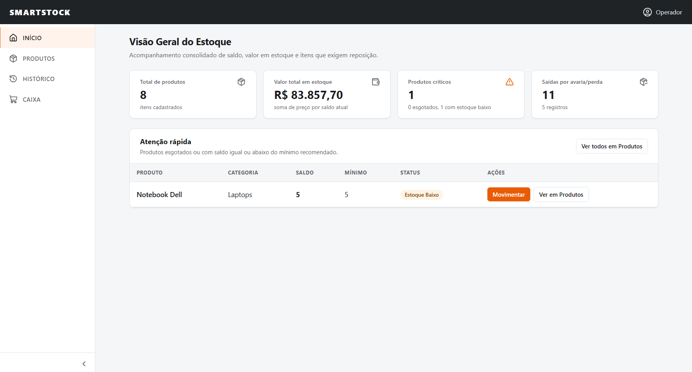
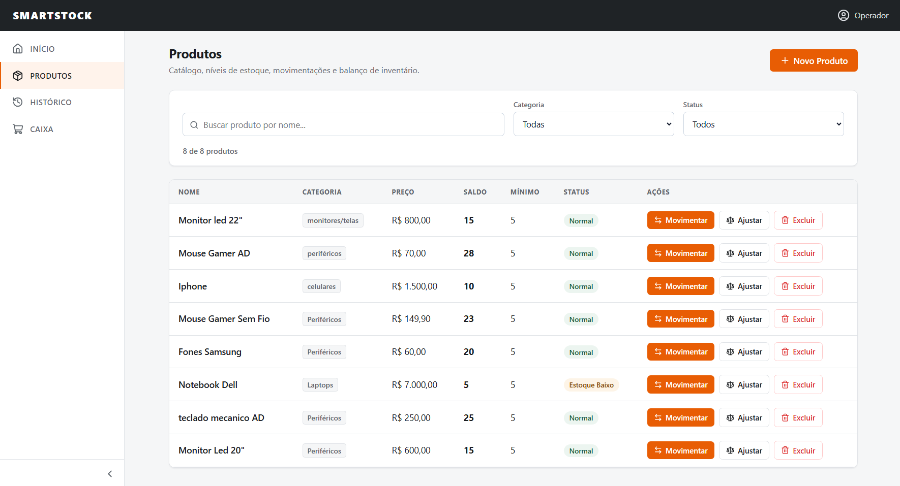
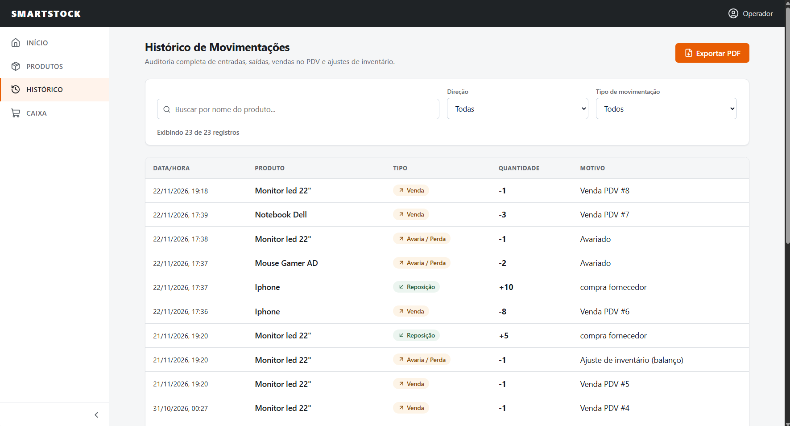
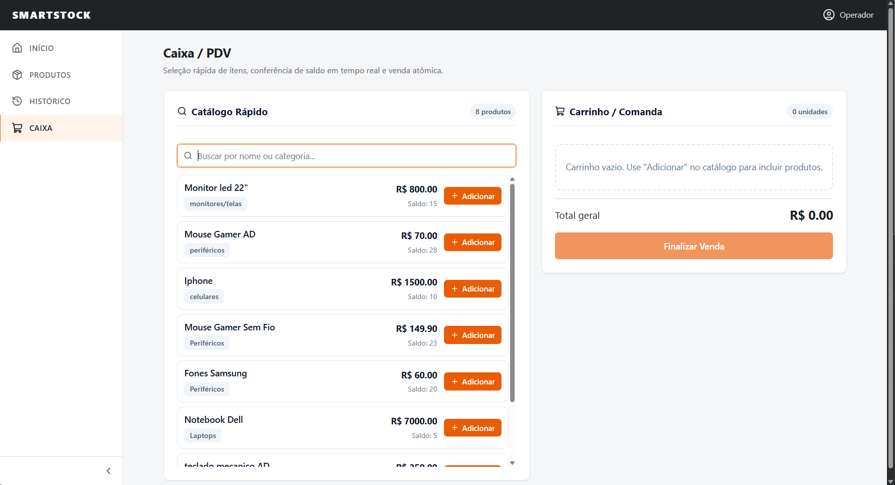
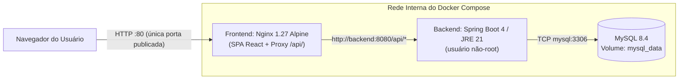

# 📦 Smart Stock

[](http://150.230.229.114/)
[](https://www.oracle.com/java/)
[](https://spring.io/projects/spring-boot)
[](https://react.dev/)
[](https://www.mysql.com/)
[](https://www.docker.com/)
[](./smart-stock-backend/src/test)

> Gestão de estoque e frente de caixa (PDV) para o varejo, em uma única aplicação web.

O Smart Stock reúne o cadastro de produtos, o controle de saldo e a venda no balcão em um só lugar.
Cada venda, reposição ou ajuste atualiza o estoque na hora e deixa um registro auditável,
que pode ser consultado com filtros e exportado em PDF.

**Destaques**

- **Venda atômica:** a venda baixa o estoque, congela o preço de cada item e registra as movimentações em uma única transação.
- **Alertas de ruptura:** o painel inicial destaca os produtos no limite do estoque mínimo ou esgotados.
- **Histórico auditável:** toda alteração de saldo gera uma movimentação, filtrável por tipo e exportável em PDF.
- **Ajuste de inventário:** a contagem física é comparada com o saldo do sistema, e a diferença vira uma movimentação compensatória.

---

## 🌐 Demonstração

- **Aplicação em execução (VM Oracle Cloud ARM64):** [http://150.230.229.114/](http://150.230.229.114/)

> **Aviso:** ambiente público de demonstração servido por HTTP e sem autenticação. Não insira dados reais ou sensíveis — os registros são compartilhados e podem ser alterados ou apagados a qualquer momento.

| **Início** | **Produtos** |
| :---: | :---: |
|  |  |
| 4 KPIs em tempo real (produtos, valor em estoque, itens críticos e avarias) e atenção rápida. | Filtros combinados (nome, categoria e status), Drawer lateral de cadastro e ajuste/balanço. |
| **Histórico** | **Caixa (PDV)** |
|  |  |
| Auditoria de entradas e saídas por direção, tipo e produto, com exportação em PDF. | Busca instantânea, carrinho em centavos com trava de saldo físico e venda atômica. |

---

## 🏗️ Arquitetura



| Camada | Tecnologias |
| :--- | :--- |
| **Frontend** | React 19, Vite, Axios, `lucide-react`, `jspdf` & `jspdf-autotable`, Oxlint |
| **Backend** | Java 21, Spring Boot 4.1.1, Spring Data JPA / Hibernate, Jakarta Validation, SpringDoc OpenAPI 3, Maven Wrapper (`mvnw`) |
| **Banco de Dados** | MySQL 8.4 (aplicação e deploy) · H2 em memória (exclusivo para testes automatizados) |
| **Containers & Proxy** | Docker Compose, builds multi-stage (`eclipse-temurin:21-jdk-noble` → `21-jre-alpine`; `node:22-alpine` → `nginx:1.27-alpine`) |

O frontend centraliza as chamadas HTTP em `src/api.js` usando caminho relativo (`/api/...`), o que elimina URLs fixas no bundle e a necessidade de CORS: em produção/Docker o Nginx encaminha `/api/` para `http://backend:8080`, e no desenvolvimento local (`npm run dev`) o proxy do Vite desempenha o mesmo papel.

---

## 🚀 Executar com Docker

### Execução local

**Pré-requisitos:** Docker com Compose (`Docker Desktop` ou `Docker Engine` + plugin `docker compose`).

1. **Crie o arquivo `.env` a partir do modelo:**

```bash
# Linux / macOS (Bash):
cp .env.example .env

# Windows (PowerShell):
Copy-Item .env.example .env
```

> **Importante:** não use `DB_USERNAME=root` (a imagem oficial `mysql:8.4` rejeita `MYSQL_USER=root` na inicialização; o modelo já define `smartstock_user`). O `.env` está no `.gitignore` e nunca deve ser commitado.

2. **Construa e suba os serviços:**

```bash
docker compose up --build -d
```

O Compose aguarda o `mysql` ficar saudável (`service_healthy`), inicia o `backend` na rede interna e publica apenas o `frontend` (Nginx).

3. **Acesse e gerencie o ambiente:**

- **URL:** [http://localhost](http://localhost) (ou `http://localhost:<FRONTEND_PORT>`, se alterada no `.env`).

```bash
# Parar os containers preservando os dados do MySQL:
docker compose down

# Parar os containers e remover também o volume de dados (mysql_data):
docker compose down -v
```

### Deploy em VM Linux (exemplo: Oracle Cloud, ARM64)

Todas as imagens base utilizadas nos Dockerfiles e no `docker-compose.yml` suportam `linux/arm64` e `linux/amd64`. Em uma instância Ubuntu 24.04 (`aarch64`):

```bash
# 1. Instalar Docker Engine + plugin Compose (repositório oficial) e clonar o projeto
git clone https://github.com/felddavi/smartstock.git
cd smartstock

# 2. Criar o .env e definir senhas fortes (ex.: gerar hashes com openssl rand -base64 24)
cp .env.example .env
nano .env

# 3. Subir a stack em background e validar saúde dos serviços
docker compose up -d --build
docker compose ps
curl -I http://localhost

# 4. Atualizar a aplicação após novos commits
git pull && docker compose up -d --build
```

> **Rede e segurança na VM:** libere apenas a porta `80/TCP` nas regras de entrada do provedor (Security List / Network Security Group) e no firewall do sistema. **Não** publique as portas `8080` (backend) nem `3306` (MySQL).

---

## 🔌 API e Testes de Requisição

<details>
<summary><strong>Ver endpoints REST, Swagger UI e coleção do Bruno</strong></summary>

<br/>

#### 📦 Produtos — `/api/produtos`

| Método | Rota | Descrição |
| :---: | :--- | :--- |
| `GET` | `/api/produtos` | Lista todos os produtos |
| `GET` | `/api/produtos/{id}` | Busca um produto pelo ID |
| `POST` | `/api/produtos` | Cadastra um novo produto |
| `PUT` | `/api/produtos/{id}` | Atualiza os dados de um produto |
| `PATCH` | `/api/produtos/{id}/estoque` | Atualiza o saldo de estoque do produto |
| `DELETE` | `/api/produtos/{id}` | Exclui um produto |

#### 🔄 Movimentações — `/api/movimentacoes`

| Método | Rota | Descrição |
| :---: | :--- | :--- |
| `GET` | `/api/movimentacoes` | Lista o histórico de movimentações |
| `POST` | `/api/movimentacoes` | Registra uma movimentação (reposição, devolução, venda ou avaria) |
| `GET` | `/api/movimentacoes/produto/{produtoId}` | Lista o histórico de movimentações de um produto |

#### 🛒 Vendas — `/api/vendas`

| Método | Rota | Descrição |
| :---: | :--- | :--- |
| `POST` | `/api/vendas` | Realiza uma venda atômica (valida itens, baixa estoque e gera movimentações) |
| `GET` | `/api/vendas` | Lista todas as vendas |
| `GET` | `/api/vendas/{id}` | Busca uma venda pelo ID, com seus itens |

#### Documentação OpenAPI e Coleção Bruno

- **Swagger UI (execução local do backend):** `http://localhost:8080/swagger-ui.html` (especificação JSON em `/v3/api-docs`).
- **Bruno:** abra o [Bruno](https://www.usebruno.com), escolha **Open Collection** e selecione a pasta `api-requests/SmartStock API` para testar as requisições prontas de **Produtos**, **Movimentações** e **Vendas**.

</details>

---

## 🧪 Testes e Qualidade

- **Backend:** testes unitários de regras de negócio (`JUnit 5` + `Mockito`), testes de contratos REST nos controllers (`@WebMvcTest`) e testes de integração transacional (`@SpringBootTest` com H2 em memória, sem depender de MySQL ativo).
  ```bash
  cd smart-stock-backend && ./mvnw test   # No Windows: .\mvnw.cmd test
  ```
- **Frontend:** ainda não possui suíte de testes automatizados; a validação é feita com análise estática (`oxlint`) e build de produção (`vite build`).
  ```bash
  cd smart-stock-frontend && npm run lint && npm run build
  ```

---

## 🧭 Decisões de Arquitetura

- **Venda em endpoint atômico:** o backend valida todos os itens do carrinho antes de alterar qualquer registro sob `@Transactional`; se um item falhar, toda a operação sofre rollback.
- **Preço congelado no item da venda:** o valor unitário é copiado para `ItemVenda` no ato da compra, preservando os totais de vendas passadas mesmo após reajustes no produto.
- **Agrupamento de itens repetidos:** quantidades de um mesmo produto enviadas em mais de uma linha são consolidadas antes da checagem, o que impede estourar o saldo dividindo o mesmo produto em várias linhas do carrinho.
- **Rastreabilidade total:** toda alteração de saldo gera um registro em `Movimentacao` (reposição, devolução, avaria, balanço ou venda).
- **Regras no backend com UX reativa no front:** cálculos em centavos e travas visuais guiam o operador, mas o backend é a autoridade final sobre saldos e validações.
- **DTOs na borda da API:** entidades JPA não são expostas nas rotas REST, evitando acoplamento externo e loops de serialização.
- **H2 apenas nos testes:** isola a suíte automatizada em memória para execução rápida em qualquer máquina.

---

## ⚠️ Limitações e Próximos Passos

- **Autenticação e autorização:** a API não tem autenticação e a demo é pública; o próximo passo é adicionar Spring Security com JWT e controle de acesso por perfil.
- **Domínio e HTTPS:** a demonstração atual responde via HTTP; o próximo passo é configurar domínio próprio e certificado TLS/HTTPS (Let's Encrypt).
- **Dados de demonstração e reset:** criar carga inicial de dados de demonstração e rotina de reset periódico para a base pública.
- **Migrações de banco:** substituir `ddl-auto=update` por migrações versionadas com **Flyway** (`ddl-auto=validate`).
- **Testes automatizados e integração:** implementar testes de interface com **Vitest** + **React Testing Library** e testes de integração com **Testcontainers** (MySQL real).
- **CI/CD e code splitting:** automatizar lint, testes e build no **GitHub Actions** e carregar `jspdf` sob demanda (`import()`) apenas ao exportar PDF.

---

## 🛠️ Desenvolvimento Local (sem Docker)

<details>
<summary><strong>Ver instruções para rodar localmente e estrutura de pastas</strong></summary>

<br/>

**Pré-requisitos:** Java 21 no `PATH`, Node.js 20+ com `npm` e MySQL 8+ ativo em `localhost:3306` (o schema `smartstock` é criado automaticamente via `createDatabaseIfNotExist=true`).

**Windows (PowerShell):**

```powershell
# Terminal 1 — Backend (http://localhost:8080)
$env:DB_USERNAME = "root"
$env:DB_PASSWORD = "sua_senha_aqui"
cd smart-stock-backend
.\mvnw.cmd spring-boot:run

# Terminal 2 — Frontend (http://localhost:5173, proxy /api -> localhost:8080)
cd smart-stock-frontend
npm install
npm run dev
```

**Linux / macOS (Bash):**

```bash
# Terminal 1 — Backend (http://localhost:8080)
export DB_USERNAME="root"
export DB_PASSWORD="sua_senha_aqui"
cd smart-stock-backend && ./mvnw spring-boot:run

# Terminal 2 — Frontend (http://localhost:5173, proxy /api -> localhost:8080)
cd smart-stock-frontend && npm install && npm run dev
```

**Estrutura principal do repositório:**

```text
smartstock/
├── .agents/               # Regras e skills de desenvolvimento assistido por IA
├── .env.example           # Variáveis de exemplo para o Docker Compose
├── docker-compose.yml     # Orquestração de mysql, backend e frontend (Nginx)
├── api-requests/          # Coleção de requisições REST para o Bruno
├── docs/                  # Contexto arquitetural e capturas de tela (docs/img)
├── smart-stock-backend/   # API REST Java 21 + Spring Boot 4 (Dockerfile incluso)
└── smart-stock-frontend/  # SPA React 19 + Vite + Nginx (Dockerfile e nginx.conf inclusos)
```

O projeto foi desenvolvido com apoio de agentes de IA, cujas diretrizes e skills ficam versionadas em `.agents/`.

</details>

---

## 👤 Autor

**Davi Feldmann** · [LinkedIn](https://br.linkedin.com/in/felddavi) · [GitHub](https://github.com/felddavi)

Feedbacks e sugestões são bem-vindos nas [issues](https://github.com/felddavi/smartstock/issues).

## 📄 Licença

Distribuído sob a licença [MIT](LICENSE). Copyright © 2026 Davi Feldmann.
